# Sản phẩm đi từ A đến Z như thế nào?

Bắt đầu ở **A**, đọc theo mũi tên có nhãn. **B** cho biết ai được làm việc gì; nhánh tiền đi qua **C** và có thể chờ người kiểm duyệt ở **D**, sau đó nhận kết quả ở **E**. **F** là nhánh sửa sai cho giao dịch đã ghi sổ.

## Chú giải thống nhất

| Hình | Ý nghĩa | Quy tắc tên |
| --- | --- | --- |
| Ô bo tròn | Bắt đầu/kết thúc hoặc dừng một yêu cầu | BẮT ĐẦU/KẾT THÚC |
| Chữ nhật xanh dương | Một người hoặc hệ thống thực hiện một việc | Dòng đầu là người/thành phần; dòng sau là động từ dễ hiểu |
| Hình thoi cam | Một câu hỏi hoặc lựa chọn | Mỗi nhánh có nhãn Có/Không hoặc tên chức năng |
| Hình trụ xanh lá | Dữ liệu được lưu bền trong PostgreSQL | Dòng đầu luôn PostgreSQL; tiếp theo ghi rõ lưu gì |
| Mũi tên liền một chiều | Bước tiếp theo trong hành trình | Nhãn mô tả điều kiện/chuyển tiếp; không dùng nó để biểu diễn quan hệ bảng |

Tất cả mũi tên có cùng ý nghĩa. Không dùng mũi tên hai chiều, đường nét đứt hoặc mũi tên ngầm mang nghĩa gọi API/response. Màu chỉ hỗ trợ; hình và chữ vẫn đủ để hiểu khi in trắng đen. Các ô có mã A01, B01... trong source để đối chiếu; không dùng mã đó thay tên hiển thị.

**Ghi sổ** nghĩa là lưu đồng thời tiền tăng/giảm, lịch sử và kết quả giao dịch. **Giữ chỗ** chỉ giảm tiền có thể sử dụng, không có nghĩa người nhận đã nhận tiền. **Chờ duyệt** và **bị từ chối** là kết quả bình thường, không phải thành công chuyển tiền.

## Cách dùng sơ đồ

- Gửi 100.000 đồng bình thường: A → B (gửi) → C (hợp lệ, không nghi ngờ) → E (cộng tiền).
- Rút hơn 1 tỷ đồng: A → B (rút) → C (đủ tiền nhưng đáng ngờ) → D. Tiền bị giữ chỗ; chỉ khi analyst duyệt mới sang E để trừ tiền.
- Hai lệnh trên 500 triệu trong 30 giây: lệnh thứ hai được xử lý gặp lệnh đã có trong lịch sử và đi vào D.
- Chuyển đến nơi cách giao dịch trước hơn 500 km hoặc thiếu vị trí: đi vào D với lý do hiển thị rõ.
- Lệnh sai quyền, không đủ tiền hoặc tài khoản không hoạt động: C trả lỗi và E hiển thị kết quả; không ghi tiền.
- Sửa sai giao dịch đã xong: chọn F, người khác kiểm duyệt rồi tạo bút toán mới; luôn còn lịch sử gốc.

Sơ đồ biểu diễn hành trình nghiệp vụ, không phải lịch trình các thread. Kiểm tra số dư/tài khoản diễn ra dưới khóa; retry cùng key được nhận diện trước khi quyết định có post lại hay không. Mọi lỗi ghi DB/rule trước commit đều rollback toàn bộ, không giữ bút toán dở dang. Mất mạng sau commit: dùng lại mã yêu cầu để đọc kết quả cũ; không tạo yêu cầu tiền mới.

## Sơ đồ

[SVG vector để mở và phóng to](diagrams/product-flow.svg) · [Mermaid source chuẩn](diagrams/product-flow.mmd)

Bản Mermaid dưới đây được đồng bộ từ source; khi sửa phải cập nhật source, render lại SVG và đồng bộ block này.

```mermaid
flowchart TB
  accTitle: Ngân hàng mô phỏng — hành trình từ A đến Z
  accDescr: Đọc từ trên xuống. Mũi tên liền là bước tiếp theo. Hình thoi là câu hỏi, chữ nhật là công việc, hình trụ là lưu dữ liệu, ô bo tròn là đầu hoặc cuối.
  subgraph A["A · ĐĂNG NHẬP VÀ CHỌN CHỨC NĂNG"]
    A01(["BẮT ĐẦU<br/>Mở ứng dụng ngân hàng"])
    A02["Người dùng<br/>Đăng nhập bằng tên và mật khẩu"]
    A03{"Hệ thống<br/>Đăng nhập hợp lệ?"}
    A04["Hệ thống<br/>Báo lỗi, chưa cho truy cập"]
    A05{"Người dùng<br/>Chọn việc cần làm theo vai trò"}
    A01 -->|Mở trang đăng nhập| A02
    A02 -->|Kiểm tra thông tin| A03
    A03 -->|Không| A04
    A04 -->|Thử lại| A02
    A03 -->|Có| A05
  end
  subgraph B["B · QUẢN LÝ VÀ TRA CỨU"]
    B01["Người dùng đúng vai trò<br/>Giao dịch viên: khách hàng và tài khoản<br/>Quản trị viên: người dùng, chi nhánh, luật<br/>Khách hàng: số dư và lịch sử của mình"]
    B02{"Hệ thống<br/>Được cấp quyền và yêu cầu hợp lệ?"}
    B03[("PostgreSQL<br/>Đọc dữ liệu được phép<br/>Hoặc lưu thay đổi kèm nhật ký<br/>Không sửa số dư bằng thao tác CRUD")]
    B04(["HOÀN TẤT<br/>Hiển thị dữ liệu hoặc kết quả quản lý<br/>Người dùng có thể đăng xuất"])
    B05(["DỪNG YÊU CẦU<br/>Giải thích lỗi, không thay đổi dữ liệu"])
    A05 -->|Quản lý hoặc tra cứu| B01
    B01 -->|Gửi yêu cầu| B02
    B02 -->|Có| B03
    B02 -->|Không| B05
    B03 -->|Trả dữ liệu hoặc xác nhận| B04
  end
  subgraph C["C · GỬI, RÚT HOẶC CHUYỂN TIỀN"]
    C01["Người tạo lệnh<br/>Giao dịch viên: gửi hoặc rút tại quầy<br/>Khách hàng: chuyển tiền nội bộ"]
    C02{"Hệ thống<br/>Quyền, dữ liệu và mã yêu cầu hợp lệ?"}
    C03["Hệ thống<br/>Nếu lặp mã cũ: trả kết quả đã có<br/>Nếu sai dữ liệu hoặc khác nội dung: báo lỗi<br/>Không xử lý tiền thêm lần nữa"]
    C04{"Hệ thống<br/>Khóa tài khoản để kiểm tra<br/>Tài khoản hoạt động?<br/>Nếu rút hoặc chuyển: đủ tiền khả dụng?"}
    C05["Bộ kiểm tra gian lận<br/>Tiền lớn hơn 1 tỷ đồng?<br/>Hai nơi liên tiếp cách hơn 500 km?<br/>Hai lệnh đều hơn 500 triệu trong 30 giây?<br/>Thiếu vị trí để kiểm tra?"]
    C06{"Hệ thống<br/>Có dấu hiệu đáng ngờ?"}
    C07[("PostgreSQL<br/>Lưu CHỜ DUYỆT và lý do<br/>Rút hoặc chuyển: giữ chỗ tiền nguồn<br/>Gửi: chưa cộng tiền<br/>Màn hình thông báo đang chờ")]
    A05 -->|Giao dịch tiền| C01
    C01 -->|Gửi lệnh với mã yêu cầu duy nhất| C02
    C02 -->|Sai hoặc là yêu cầu lặp| C03
    C02 -->|Lệnh mới hợp lệ| C04
    C03 -->|Hiển thị kết quả đúng trạng thái| C09
    C04 -->|Không: chưa xử lý tiền| C09
    C04 -->|Có: đọc lịch sử của tài khoản| C05
    C05 -->|Tổng hợp lý do và bằng chứng| C06
    C06 -->|Có| C07
    C09(["HOÀN TẤT YÊU CẦU<br/>Hiển thị lỗi hoặc kết quả đã có<br/>Người dùng có thể đăng xuất"])
  end
  subgraph D["D · NGƯỜI KIỂM DUYỆT XỬ LÝ LỆNH ĐANG CHỜ"]
    D01["Người kiểm duyệt<br/>Mở danh sách chờ, đọc bằng chứng<br/>Nhập quyết định và lý do<br/>Không tự duyệt lệnh mình tạo"]
    D02{"Người kiểm duyệt<br/>Duyệt hay từ chối?"}
    D03[("PostgreSQL<br/>Lưu TỪ CHỐI và lý do<br/>Giải phóng tiền giữ chỗ nếu có<br/>Không tạo bút toán tiền")]
    D04{"Hệ thống<br/>Điều kiện ghi sổ còn hợp lệ?"}
    D05(["GIỮ NGUYÊN CHỜ DUYỆT<br/>Báo điều kiện cần xử lý<br/>Có thể xem lại hoặc từ chối sau"])
    D06(["HOÀN TẤT<br/>Hiển thị lệnh bị từ chối<br/>Người dùng có thể đăng xuất"])
    C07 -->|Sau đó, người kiểm duyệt chọn lệnh| D01
    D01 -->|Kiểm tra quyền và trạng thái| D02
    D02 -->|Từ chối| D03
    D03 -->|Thông báo kết quả| D06
    D02 -->|Duyệt| D04
    D04 -->|Không| D05
  end
  subgraph E["E · GHI SỔ VÀ XEM KẾT QUẢ"]
    E01[("PostgreSQL<br/>LƯU ĐỒNG THỜI TRONG MỘT GIAO DỊCH DB<br/>Gửi: cộng tiền; rút: trừ tiền<br/>Chuyển: trừ nguồn và cộng đích<br/>Lưu bút toán cân bằng và nhật ký<br/>Dùng tiền giữ chỗ nếu lệnh đã chờ duyệt")]
    E02["Người dùng<br/>Xem giao dịch ĐÃ GHI SỔ<br/>Số dư, tiền giữ chỗ và lịch sử được cập nhật<br/>Chỉ xem dữ liệu được cấp quyền"]
    E03{"Giao dịch viên<br/>Có cần sửa sai giao dịch đã ghi sổ?"}
    E04(["KẾT THÚC<br/>Đăng xuất và hủy phiên đăng nhập"])
    C06 -->|Không: cho phép ghi sổ| E01
    D04 -->|Có: chấp nhận quyết định duyệt| E01
    E01 -->|Chỉ báo thành công sau khi lưu xong| E02
    E02 -->|Có thể yêu cầu sửa sai qua giao dịch viên| E03
    E03 -->|Không| E04
  end
  subgraph F["F · SỬA SAI VÀ GIỮ NGUYÊN LỊCH SỬ"]
    F01["Giao dịch viên<br/>Tạo yêu cầu đảo với lý do<br/>Người kiểm duyệt khác xem xét"]
    F02{"Người kiểm duyệt và hệ thống<br/>Đồng ý đảo, chưa từng đảo,<br/>đủ tiền và tài khoản còn hoạt động?"}
    F03[("PostgreSQL<br/>Tạo bút toán mới đối dấu cân bằng<br/>Đánh dấu giao dịch gốc ĐÃ ĐẢO<br/>Giữ lại lịch sử gốc và lý do")]
    F04(["HOÀN TẤT XEM XÉT<br/>Từ chối: lưu lý do, không đổi tiền<br/>Chưa đủ điều kiện: giữ yêu cầu chờ<br/>Thông báo rõ trạng thái"])
    F05(["KẾT THÚC<br/>Hiển thị lệnh gốc và lệnh đảo<br/>Có thể đăng xuất"])
    E03 -->|Có: chỉ lệnh đã ghi sổ| F01
    F01 -->|Không sửa hoặc xóa bút toán cũ| F02
    F02 -->|Có| F03
    F02 -->|Không| F04
    F03 -->|Hiển thị lịch sử đầy đủ| F05
  end
  classDef action fill:#eff6ff,stroke:#2563eb,color:#172554
  classDef decision fill:#fff7ed,stroke:#c2410c,color:#431407
  classDef storage fill:#ecfdf5,stroke:#047857,color:#022c22
  classDef terminal fill:#f1f5f9,stroke:#475569,color:#0f172a
  class A02,A04,B01,C01,C03,C05,D01,E02,F01 action
  class A03,A05,B02,C02,C04,C06,D02,D04,E03,F02 decision
  class B03,C07,D03,E01,F03 storage
  class A01,B04,B05,C09,D05,D06,E04,F04,F05 terminal
```

