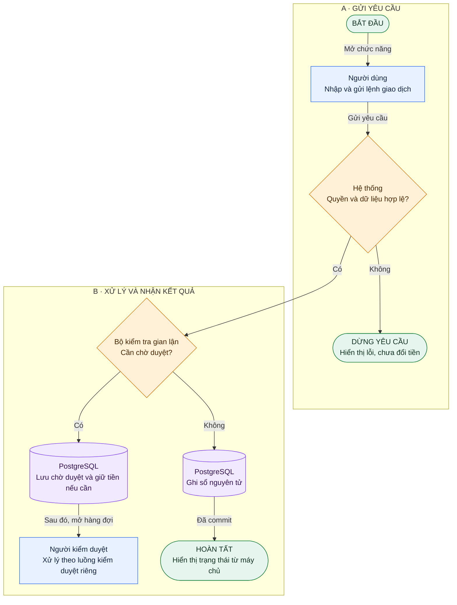

# chartdrawing_TRICK — Quy chuẩn Mermaid nhất quán

## Tên, ô và mũi tên

| Ký hiệu | Ý nghĩa cố định |
| --- | --- |
| `(["..."])` | Bắt đầu/kết thúc/dừng yêu cầu |
| `["..."]` | Người hoặc hệ thống thực hiện hành động |
| `{"...?"}` | Điều kiện/quyết định; các nhánh có nhãn |
| `[("...")]` | Dữ liệu được lưu trong database |
| `-->` | Bước xử lý tiếp theo trong flowchart sản phẩm |
| `-.->` | Chỉ dành cho chú thích/liên hệ tham khảo nếu có; ghi chú giải |

Dùng `flowchart TD` cho sản phẩm A–Z. Chia subgraph A/B/C… theo giai đoạn; ID ổn định `A01`, `C04`, không dùng ID như nhãn nghiệp vụ. Nhãn hành động: “Thành phần Động từ + đối tượng”. Nhãn quyết định là câu hỏi; nhánh ghi Có/Không hoặc Duyệt/Từ chối. Nhánh bất đồng bộ ghi rõ “Sau đó…” để người đọc không hiểu nhầm là cùng request.

Giữ một thuật ngữ: “Lệnh giao dịch”, “Bút toán”, “Chờ duyệt”, “Số dư khả dụng”. Không dùng “account” lúc là user, lúc là tài khoản tiền. Không dùng mũi tên hai chiều chỉ để tiết kiệm đường; vẽ rõ chiều và ý nghĩa. Sequence diagram có quy ước riêng: `->>` request, `-->>` response; ghi chú giải ngay tại sơ đồ, không trộn với flowchart.

## Màu có nghĩa, không phải trang trí

Hành động xanh dương, quyết định cam, lưu trữ tím, kết thúc xanh lá/nhạt. Chữ phải tự giải thích được khi in đen trắng. Một trạng thái lỗi không chỉ được biểu diễn bằng màu đỏ.

## Mẫu hợp lệ

Mẫu này minh họa ký hiệu, không thay thế toàn bộ luồng kiểm duyệt. Sơ đồ A–Z hoàn chỉnh xem [product-flow](../../backend/design/product-flow.md).

## Checklist trước bàn giao

Mỗi node đều có đường tới/đi hợp lý; mọi quyết định có nhãn nhánh; không có trạng thái chờ biến thành posted vô điều kiện; mỗi nhóm đọc được theo một chiều; tên khớp contract; có chú giải và lời diễn giải. Nếu sơ đồ quá dày, tách overview và sơ đồ chi tiết, dùng ID/link để nối ngữ cảnh.

Dùng chuỗi nhãn trong dấu nháy và ` ` để xuống dòng. Tránh ký tự cú pháp chưa escape trong nhãn. Render bằng Mermaid có sẵn khi cần xuất bản; với sửa tài liệu nhỏ chỉ cần kiểm tra fence, cấu trúc và link, không cài thêm cả bộ browser test để xác nhận vài dòng Markdown.
